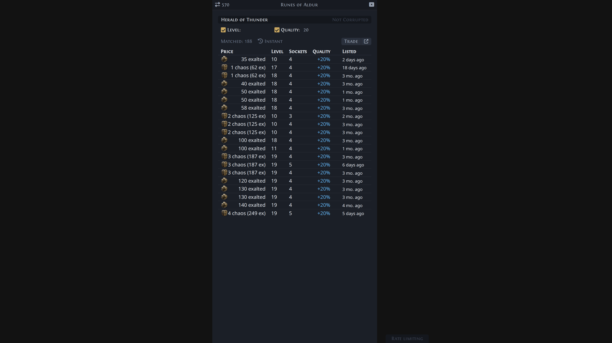
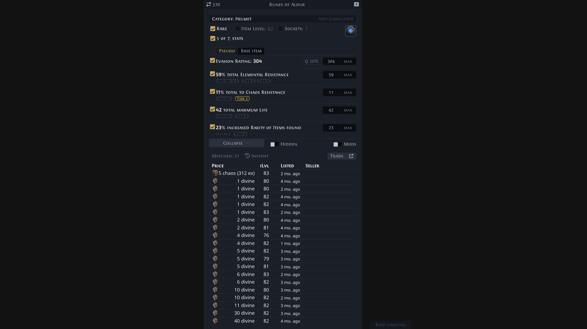
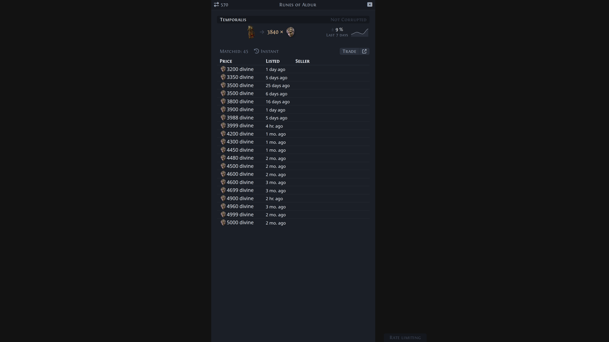
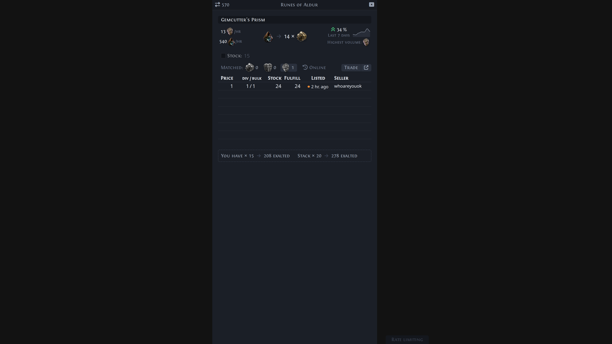

#  Exiled Exchange 2

Path of Exile 2 overlay program for price checking items, among many other loved features.

This is a fork of [Kvan7/Exiled-Exchange-2](https://github.com/Kvan7/Exiled-Exchange-2), which is itself a fork of [Awakened PoE Trade](https://github.com/SnosMe/awakened-poe-trade).

## What this fork changes

- **Gamepad support.** Price check with `R3 + RT`, locked price check with `L3 + RT`, and the gamepad B button toggles the overlay. Overlay windows can be driven with the gamepad (d-pad navigation, auto-repeat, popover handling), and the settings UI includes gamepad configuration. The 8BitDo Pro 2 profile is included.
- **Native KDE Plasma 6 Wayland overlay.** On KDE Wayland sessions the overlay runs through a KWin script bridge instead of XWayland, with game window tracking, overlay positioning and global shortcuts handled through KWin. X11 sessions are unaffected.
- **Linux builds.** Releases include a Linux AppImage with automatic updates alongside the Windows installer and portable builds.
- **Tag-driven releases.** Pushing a `v*` tag builds and publishes Windows and Linux artifacts with auto-update feeds on this repository's [Releases](https://github.com/ys-kalyakin/Exiled-Exchange-2/releases) page.

Windows remains the primary platform. macOS builds are not provided by this fork.

See [docs/gamepad-roadmap.md](./docs/gamepad-roadmap.md) for the gamepad support status and plans, and [DEVELOPING.md](./DEVELOPING.md) for development documentation.

## Download

Grab the latest release from [GitHub Releases](https://github.com/ys-kalyakin/Exiled-Exchange-2/releases/latest). As of v0.16.3, a release includes:

- `Exiled-Exchange-2-Setup-0.16.3.exe` — Windows 10+ installer, with automatic updates
- `Exiled-Exchange-2-0.16.3.exe` — Windows 10+ portable, no automatic updates
- `Exiled-Exchange-2-0.16.3.AppImage` — Linux, with automatic updates (`latest.yml` / `latest-linux.yml` update feeds are published alongside)

The app is unsigned, so you will have to bypass Windows security warnings to run it.

## Moving from POE1/Awakened PoE Trade

1. Download latest release from [releases](https://github.com/ys-kalyakin/exiled-exchange-2/releases)
2. Run installer
3. Run Exiled Exchange 2
4. Launch PoE2 to generate correct files
5. Quit PoE2 and EE2 after seeing the banner popup that EE2 loaded
6. Copy `apt-data` from `%APPDATA%\awakened-poe-trade` to `%APPDATA%\exiled-exchange-2` to copy your previous settings
  - Resulting directory structure should look like this:
  - `%APPDATA%\exiled-exchange-2\apt-data\`
    - `config.json`
7. Edit `config.json` and change the value of "windowTitle": "Path of Exile" to instead be "Path of Exile 2", otherwise it will open only for poe1
8. Start Exiled Exchange 2 and PoE2

## FAQ

<https://kvan7.github.io/Exiled-Exchange-2/faq>

## Tool showcase

| Gem                                                | Rare                                                 | Unique                                                   | Currency                                                     |
| -------------------------------------------------- | ---------------------------------------------------- | -------------------------------------------------------- | ------------------------------------------------------------ |
|  |  |  |  |

### Development

See [DEVELOPING.md](./DEVELOPING.md)

### Acknowledgments

- [Exiled Exchange 2](https://github.com/Kvan7/Exiled-Exchange-2) — the upstream project this fork is based on
- [awakened-poe-trade](https://github.com/SnosMe/awakened-poe-trade)
- [libuiohook](https://github.com/kwhat/libuiohook)
- [RePoE](https://github.com/brather1ng/RePoE)
- [poeprices.info](https://www.poeprices.info/)
- [poe.ninja](https://poe.ninja/)
